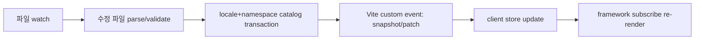

# 02. 아키텍처

이 문서는 Saylo의 계층 구조, 상태 모델, 개발 중 반영 경로의 소유권을 정한다. 갱신 프로토콜의 wire 타입과 적용 규칙은 [08-update-protocol.md](08-update-protocol.md)가 단일 출처다.

## 계층

| 계층 | 책임 | 비고 |
| --- | --- | --- |
| core | 카탈로그 정규화, 파싱·검증, 포맷, 폴백, store, 공개 타입 | 프레임워크 중립 TypeScript |
| dev plugin | 파일 watch, 변경 파일 처리, 갱신 이벤트 전달 | 첫 구현은 Vite plugin |
| typegen worker | 기준 스키마에서 generated types 생성 | 배경 작업, build에서 대기 |
| adapters | 프레임워크 구독·재렌더 연결 | vanilla subscription, React 우선 |
| catalog source | 개발·운영에서 카탈로그를 조회하는 공통 인터페이스 | 개발은 범용 조회, 운영은 정적 map |

core는 배포 시 ESM JavaScript와 `.d.ts`로 제공한다. TypeScript로 작성하고, 사용자가 JS 프로젝트에서도 쓸 수 있도록 타입은 선언 파일로 분리한다. 선언 파일 배포 형태는 [TypeScript 선언 파일 배포](https://www.typescriptlang.org/docs/handbook/declaration-files/publishing.html) 관례를 따른다.

## 개발 반영 경로

각 단계의 계약:

- watch: 저장 시 발생하는 파일 이벤트를 debounce해 최종값으로 수렴시킨다. 편집 도구가 임시 파일을 거치는 경우 최종 상태 기준으로 판단한다.
- parse/validate: 파싱은 바뀐 파일만 한다. 기준 schema가 바뀌면 그 영향을 받는 secondary 메시지의 재검증이 필요하다. 이미 파싱한 AST와 인자 정보를 재사용하므로 전체 파일을 다시 읽는다는 뜻은 아니다.
- catalog transaction: 로케일+namespace 단위로 후보를 검증하고 원자적으로 커밋한다. 성공하면 revision이 증가하고, 실패하면 이전 카탈로그를 유지한다.
- event: 영향받은 카탈로그 전체 스냅샷을 전달한다. 임의 객체 조각을 흘려보내지 않는다.
- store: instance 단위 상태를 갱신하고 구독자에게 알린다.
- re-render: 구독한 프레임워크가 다시 렌더링한다. 화면 컴포넌트를 remount하지 않는다.

delete, rename, add도 같은 경로를 탄다. 파일 삭제·이름 변경·추가가 최종적으로 하나의 정합적인 카탈로그로 수렴해야 한다. 파이프라인이 어긋난 것으로 보이면 전체 스냅샷을 다시 받는 recovery resync를 수행한다.

## 후보 registry와 배치 게시

파일 삭제·이름 변경·추가가 몰릴 때 개별 파일 단위로 먼저 게시하지 않는다. 다음 순서로 배치를 판정한다.

- 안정화한 파일 집합으로 후보 registry를 만든다. rename이나 atomic save가 남기는 transient 상태는 짧은 quiet window 동안 다시 읽어 최종 상태로 수렴시킨다. 영원히 기다리지 않고, 창이 끝나면 그때의 상태로 판정한다.
- 실제 파일 시스템에서 기준 로케일 루트 존재와 최소 정상 기준 카탈로그 조건을 검사한다. 조건을 못 맞추면 그 배치를 통째로 거부한다.
- namespace 삭제는 허용하고 기준 로케일 전체 삭제는 거부한다. 이 둘을 구분한다. 삭제 전에 시작한 load가 되살아나지 않도록 tombstone version을 보존한다.
- 서버가 받아들인 기준 변경과 부적합해진 secondary의 quarantine는 같은 배치로 게시한다. 일부만 먼저 노출하지 않는다.
- 처음 마주친 기준 카탈로그가 유효하지 않으면 명시적 치명 오류로 멈춘다. 값을 그대로 노출하는 가짜 카탈로그를 만들지 않는다.
- 이미 독립적으로 커밋한 과거 배치까지 자동으로 되돌리는 것은 약속하지 않는다.

## 개발 서버 플러그인 (Vite)

첫 개발 서버 구현은 Vite plugin이다.

- 커스텀 이벤트 전달은 Vite 공식 방식인 `handleHotUpdate`에서 처리한다. 영향받은 카탈로그 정보를 담은 커스텀 이벤트를 보낸 뒤 빈 배열(`[]`)을 반환해 기본 HMR 전파를 막는다. 이 `[]` 반환은 그 훅 처리 범위의 공식 방식이다. 전체 모듈 그래프나 다른 plugin의 watch 경로까지 통제한다는 보장은 아니다. 근거는 [Vite HMR API](https://vite.dev/guide/api-hmr)다.
- 파일 추가·삭제(`add`/`unlink`)는 change와 경로가 다르므로 watcher 이벤트를 별도로 등록해 처리한다.
- 같은 파일 change가 짧은 시간에 중복으로 들어오면 중복 커밋을 만들지 않는다. debounce로 최종 상태에 수렴시키고, 반영할 payload의 content hash가 실제로 달라진 경우에만 revision을 올린다.
- 카탈로그 소스 파일을 앱 코드에서 직접 import하거나 glob으로 묶지 않는다. 그렇게 묶인 카탈로그는 Saylo plugin 관리 경로 밖이고 일반 Vite HMR을 따른다. Saylo 경로는 virtual module과 catalog source를 통한다. 직접 import나 glob이 감지되면 warning 진단으로 알린다.
- saylo가 생성한 `.d.ts`와 typegen 임시 파일 경로는 Saylo의 감시·이벤트 범위에서 제외한다. 임시 파일의 add/unlink가 앱 watch HMR을 유발하지 않도록 좁은 ignore 규칙을 두고 검증한다.
- 이벤트 등록 책임은 한곳으로 모은다. 등록은 `connectDev`가 소유하고 virtual module은 handle과 data만 노출한다.

### 소유권과 정리

- `connectDev(instance)`는 같은 instance에 대해 단일 binding만 유지하고 idempotent한 disposer를 반환한다. 같은 instance에 중복 호출해도 listener를 새로 쌓지 않고, 이미 붙은 binding의 disposer를 그대로 돌려준다.
- Vite dev server가 watcher와 websocket을 소유한다. Saylo plugin은 자신이 등록한 listener, route, channel binding만 소유하고 해제한다. 공유 watcher와 socket은 닫지 않는다.
- `instance.dispose`는 그 instance가 붙인 bridge 구독을 해제한다. HMR `hot.dispose`와 prune 정리 경로에서도 Saylo가 등록한 listener만 해제하고 공유 server websocket은 유지한다.
- plugin은 dev 서버 종료 시 자신이 등록한 listener, route, channel binding만 정리한다.

## 시작 핸드셰이크

클라이언트가 먼저 커스텀 이벤트 리스너를 등록하고, 그다음 full snapshot을 요청한다. 리스너 등록과 snapshot 도착 사이에 도착한 patch는 버퍼에 담는다. 버퍼, gap, 재연결, 세션 전환, 오래된 요청 응답 처리 규칙은 [08-update-protocol.md](08-update-protocol.md)를 따른다.

## store 모델

상태를 세 층으로 나눈다.

| 상태 | 담는 것 | 노출 |
| --- | --- | --- |
| transport 상태 (내부) | sessionId(개발 서버 세션, 운영 artifact ID), registryRevision, requestGeneration, patch buffer, (locale, namespace)별 알려진 catalogVersion과 tombstone, 진행 중 requestId | 공개하지 않는다 |
| 카탈로그 레코드 (불변) | locale, namespace, catalogVersion, namespaceSchemaFingerprint, formatLocale(출처 locale), AST 메시지와 메시지 fingerprint | render가 읽는다 |
| UI snapshot (공개) | locale, availableLocales, availableNamespaces, loadedNamespaces, stateRevision, render용 불변 카탈로그와 accepted base schema | 구독자에게 알린다 |

- `ReadonlyMap` 타입만으로 freeze되지 않는다. persistent 또는 copy-on-write로 이전 snapshot이 공유한 객체를 제자리에서 수정하지 않는다.
- 미로드이거나 비활성인 locale 카탈로그 내용만 바뀌면 transport 상태만 바뀌고 UI snapshot 참조는 유지한다.
- locale 목록이나 namespace 목록처럼 UI에 보이는 변화는 알림이 필요하다. 현재 locale 카탈로그나 base fallback 내용이 바뀌면 stateRevision을 올린다. registry revision, session, dirty 표시는 전송 타이밍 정보이므로 공개 UI 변경을 강제하지 않는다.

selector 단위 미세구독은 후속 최적화다. MVP에서 컴포넌트 하나가 통째로 remount되는 일은 없지만, 같은 카탈로그를 쓰는 여러 컴포넌트가 함께 다시 렌더링될 수 있다는 점은 감수한다.

registry revision은 transport 순서를 맞추는 값이다. instance stateRevision은 UI 구독 identity다. 로케일 전환은 stateRevision만 올린다. 두 값을 한 카운터로 합치지 않는다.

## 어댑터

- vanilla subscription: core store를 직접 구독하는 최소 어댑터.
- React: `createSayloReact<AppSchema>()` factory가 Provider와 `useI18n`을 같은 context로 함께 만든다. Provider에 전달한 제네릭이 멀리 떨어진 `useI18n()` 호출로 자동 전파된다는 계약은 두지 않는다. factory가 만든 context를 통해서만 타입이 연결된다.
- React hook은 [useSyncExternalStore](https://react.dev/reference/react/useSyncExternalStore) 방식으로 store 스냅샷을 구독한다. hook이 돌려주는 `t`는 그 렌더가 선택한 불변 UI snapshot에 바인딩한다. 일반 `instance.t`는 최신 snapshot을 읽는다. 이 구분이 없으면 hydration이 읽은 snapshot과 실제 문자열이 다른 revision이 될 수 있다. locale이나 카탈로그 revision이 바뀌면 구독 컴포넌트만 다시 렌더링하고 DOM 노드는 remount하지 않는다.
- `getSnapshot`은 변화가 없으면 같은 참조를 반환한다(`Object.is` 비교). 실제 카탈로그나 로케일이 갱신될 때만 새 immutable 스냅샷을 만든다. `subscribe`/`getSnapshot` 참조는 안정적으로 유지한다. 서버 렌더링에서는 `getServerSnapshot`이 브라우저 부팅 시점과 동등한 데이터를 돌려준다.
- Svelte, Vue: 초기 구현 대상이 아니다. 코어가 프레임워크 중립이므로 후속 어댑터로 붙인다.

React 훅 밖에서 일반 `t(...)`로 얻은 결과 문자열은 자동으로 갱신되지 않는다. 갱신이 필요하면 구독 경로(훅 또는 store 구독)를 통과해야 한다. 이 제약은 문서와 타입 주석에 명시한다.

remount 방지는 Saylo가 소유한 provider identity와 root key를 유지하는 범위에 한정된다. 소비자가 locale을 React key로 써서 화면을 다시 만들거나 리렌더 구조를 바꾸면 보장 범위 밖이다. 문구 길이 변화로 생기는 text reflow 때문에 스크롤 위치가 밀리는 것과, full reload로 입력값이 사라지는 상태 손실은 다른 문제다. Saylo가 줄이는 것은 후자이고, 전자는 레이아웃 설계로 다룬다.

## 오류 처리 원칙

파싱·검증 실패는 카탈로그를 오염시키지 않는다. 실패 시 유지·복구·진단 규칙은 [04-live-update-and-types.md](04-live-update-and-types.md)를 따른다.
