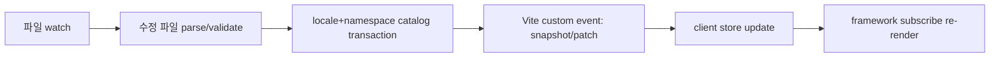

# 02. 아키텍처

이 문서는 Saylo의 계층 구조와 개발 중 반영 경로를 정한다.

## 계층

| 계층 | 책임 | 비고 |
| --- | --- | --- |
| core | 카탈로그 정규화, 파싱·검증, 포맷, 폴백, store, 공개 타입 | 프레임워크 중립 TypeScript |
| dev plugin | 파일 watch, 변경 파일 처리, 갱신 이벤트 전달 | 첫 구현은 Vite plugin |
| typegen worker | 기준 스키마에서 generated types 생성 | 배경 작업, build에서 대기 |
| adapters | 프레임워크 구독·재렌더 연결 | vanilla subscription, React 우선 |
| runtime loaders | 운영에서 지연 로딩되는 카탈로그 로더 | 정적 loader map |

core는 배포 시 ESM JavaScript와 `.d.ts`로 제공한다. TypeScript로 작성하고, 사용자가 JS 프로젝트에서도 쓸 수 있도록 타입은 선언 파일로 분리한다. 선언 파일 배포 형태는 [TypeScript 선언 파일 배포](https://www.typescriptlang.org/docs/handbook/declaration-files/publishing.html) 관례를 따른다.

## 개발 반영 경로

각 단계의 계약:

- watch: 저장 시 발생하는 파일 이벤트를 debounce해 최종값으로 수렴시킨다. 편집 도구가 임시 파일을 거치는 경우 최종 상태 기준으로 판단한다.
- parse/validate: 바뀐 파일만 처리한다. 전체 프로젝트를 다시 파싱하지 않는다.
- catalog transaction: 로케일+namespace 단위로 커밋한다. 성공하면 revision이 증가하고, 실패하면 이전 카탈로그를 유지한다.
- event: 영향받은 카탈로그 전체 스냅샷을 전달한다. 임의 객체 조각을 흘려보내지 않는다.
- store: instance 단위 상태를 갱신하고 구독자에게 알린다.
- re-render: 구독한 프레임워크가 다시 렌더링한다. 화면 컴포넌트를 remount하지 않는다.

delete, rename, add도 같은 경로를 탄다. 파일 삭제·이름 변경·추가가 최종적으로 하나의 정합적인 카탈로그로 수렴해야 한다. 파이프라인이 어긋난 것으로 보이면 전체 스냅샷을 다시 받는 recovery resync를 수행한다.

## 개발 서버 플러그인 (Vite)

첫 개발 서버 구현은 Vite plugin이다.

- 커스텀 이벤트 전달은 Vite 공식 방식인 `handleHotUpdate`에서 처리한다. 영향받은 카탈로그 정보를 담은 커스텀 이벤트를 보낸 뒤 빈 배열(`[]`)을 반환해 기본 HMR 전파를 막는다. 이렇게 해야 전체 큐 무효화나 모듈 그래프 갱신으로 새지 않는다. 근거는 [Vite HMR API](https://vite.dev/guide/api-hmr)다.
- 파일 추가·삭제(`add`/`unlink`)는 change와 경로가 다르므로 watcher 이벤트를 별도로 등록해 처리한다.
- 같은 파일의 change 이벤트가 짧은 시간에 중복으로 들어오면 중복 커밋을 만들지 않는다. debounce로 최종 상태에 수렴시키고, 반영할 payload의 content hash가 실제로 달라진 경우에만 revision을 올린다.
- 카탈로그 소스 파일을 앱 코드에서 직접 import하지 않는다. 직접 import한 JSON은 Saylo plugin 관리 경로 밖에 있고 일반 Vite HMR을 따른다. Saylo 경로는 virtual module과 loader를 통한다.
- 클라이언트는 개발에서 `connectDev(instance)`로 어떤 instance를 갱신할지 plugin에 알린다. 이 호출이 없으면 plugin은 어느 store에 이벤트를 적용할지 알 수 없다. 시그니처와 예제는 [03-catalog-and-api.md](03-catalog-and-api.md)를 따른다.

## 시작 핸드셰이크

클라이언트가 먼저 커스텀 이벤트 리스너를 등록하고, 그다음 full snapshot을 요청한다. 리스너 등록과 snapshot 도착 사이에 도착한 patch는 버퍼에 담아 두었다가, snapshot의 revision과 `baseRevision`이 맞는 patch만 순서대로 적용한다. 이 순서를 지키지 않으면 시작 직후 이벤트를 놓치거나 이중 적용한다.

## store 모델

store는 instance 단위 상태를 들고 있다. 이번 MVP가 노출하는 구독 단위는 로케일과 카탈로그 revision의 변경이다. 즉 구독자는 "내 로케일의 내 카탈로그가 새 revision이 되었다"는 알림을 받고 다시 렌더링한다.

selector 단위 미세구독은 후속 최적화다. MVP에서 컴포넌트 하나가 통째로 remount되는 일은 없지만, 같은 카탈로그를 쓰는 여러 컴포넌트가 함께 다시 렌더링될 수 있다는 점은 감수한다.

registry 전역 revision은 카탈로그 전송(transport)의 순서를 맞추는 값이다. instance snapshot identity는 UI 구독을 위한 값이며, 로케일 전환은 이쪽만 갱신한다. 로케일 전환이 registry revision을 올리지 않는다.

## 어댑터

- vanilla subscription: core store를 직접 구독하는 최소 어댑터.
- React: Provider + `useI18n` 훅. [useSyncExternalStore](https://react.dev/reference/react/useSyncExternalStore) 방식으로 store 스냅샷을 구독한다. locale이나 catalog revision이 바뀌면 구독 컴포넌트만 다시 렌더링하고, DOM 노드는 remount하지 않는다.
- React의 `getSnapshot`은 변화가 없으면 같은 참조를 반환한다(`Object.is` 비교). 실제 카탈로그나 로케일이 갱신될 때만 새 immutable 스냅샷을 만든다. `subscribe`/`getSnapshot` 참조는 안정적으로 유지한다. 서버 렌더링에서는 `getServerSnapshot`이 브라우저 부팅 시점과 동등한 데이터를 돌려준다.
- Svelte, Vue: 초기 구현 대상이 아니다. 코어가 프레임워크 중립이므로 후속 어댑터로 붙인다.

React 훅 밖에서 일반 `t(...)`로 얻은 결과 문자열은 자동으로 갱신되지 않는다. 갱신이 필요하면 구독 경로(훅 또는 store 구독)를 통과해야 한다. 이 제약은 문서와 타입 주석에 명시한다.

remount 방지는 Saylo가 소유한 provider identity와 root key를 유지하는 범위에 한정된다. 소비자가 locale을 React key로 써서 화면을 다시 만들거나 리렌더 구조를 바꾸면 보장 범위 밖이다. 문구 길이 변화로 생기는 text reflow 때문에 스크롤 위치가 밀리는 것과, full reload로 입력값이 사라지는 상태 손실은 다른 문제다. Saylo가 줄이는 것은 후자이고, 전자는 레이아웃 설계로 다룬다.

## 오류 처리 원칙

파싱·검증 실패는 카탈로그를 오염시키지 않는다. 실패 시 유지·복구·진단 규칙은 [04-live-update-and-types.md](04-live-update-and-types.md)를 따른다.
