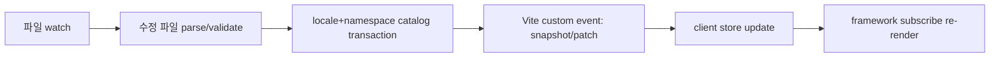

# 02. Architecture

This document defines Saylo's layered structure, state model, and ownership of the development update path. [08-update-protocol.md](08-update-protocol.md) is the single source for the update protocol's wire types and application rules.

## Layers

| Layer | Responsibility | Notes |
| --- | --- | --- |
| core | Catalog normalization, parsing and validation, formatting, fallback, store, and public types | Framework-neutral TypeScript |
| dev plugin | File watching, modified-file processing, and update event delivery | The first implementation is a Vite plugin |
| typegen worker | Generates generated types from the base schema | A background task that the build waits for |
| adapters | Connect framework subscriptions and re-rendering | Vanilla subscription, React first |
| catalog source | A common interface for retrieving catalogs in development and production | General lookup in development, static maps in production |

The core is distributed as ESM JavaScript and `.d.ts` files. It is written in TypeScript, and types are split into declaration files so that users can also use it in JS projects. The declaration-file distribution shape follows the [TypeScript declaration file publishing](https://www.typescriptlang.org/docs/handbook/declaration-files/publishing.html) convention.

## Development update path

The contract for each step:

- watch: Debounce file events produced by saves so they converge on the final value. When an editing tool goes through a temporary file, decide based on the final state.
- parse/validate: Parse only changed files. If the base schema changes, affected secondary messages need to be revalidated. Reuse already parsed ASTs and argument information; this does not mean rereading every file.
- catalog transaction: Validate the candidate for each locale+namespace and commit it atomically. A successful commit increments the revision; a failed one retains the previous catalog.
- event: Send the complete snapshot of each affected catalog. Do not leak arbitrary object fragments.
- store: Update instance-level state and notify subscribers.
- re-render: The subscribing framework re-renders. Do not remount screen components.

Deletes, renames, and additions take the same path. File deletion, renaming, and addition must eventually converge on one consistent catalog. If the pipeline appears to have drifted, perform a recovery resync that fetches the full snapshot again.

## Candidate registry and batch publishing

When file deletions, renames, and additions arrive together, do not publish individual files first. Determine the batch in the following order.

- Build a candidate registry from the stabilized file set. During a short quiet window, reread transient states left by renames or atomic saves so they converge on the final state. Do not wait forever; when the window ends, decide based on the state at that point.
- Check that the base-locale root exists on the actual file system and that the minimum valid base-catalog conditions are met. If they are not met, reject the entire batch.
- Allow namespace deletion and reject deletion of the entire base locale. Distinguish these two cases. Preserve tombstone versions so that loads started before deletion do not revive.
- Publish accepted base changes and the quarantine of secondary catalogs made incompatible by them in the same batch. Do not expose only part of the batch first.
- If the first base catalog encountered is invalid, stop with an explicit fatal error. Do not create a fake catalog that exposes values as if they were valid.
- Do not promise automatic rollback of past batches that were already committed independently.

## Development server plugin (Vite)

The first development server implementation is a Vite plugin.

- The current Vite 8 implementation uses `hotUpdate`, which receives create/update/delete together. For managed paths it returns an empty array (`[]`), evaluates the collected file events, and applies them through a custom event. Returning `[]` suppresses the hook's default HMR propagation; each other plugin owns its own watch path. This is based on the [Vite HMR API](https://vite.dev/guide/api-hmr).
- File additions and deletions (`add`/`unlink`) take a different path from changes, so register and handle separate watcher events.
- When duplicate changes for the same file arrive within a short period, do not create duplicate commits. Debounce them so they converge on the final state, and increment the revision only when the content hash of the payload to apply has actually changed.
- Do not import catalog source files directly from app code or bundle them with a glob. Catalogs bundled that way are outside the Saylo plugin's managed path and follow normal Vite HMR. The Saylo path goes through virtual modules and catalog sources. When a direct import or glob is detected, report it as a warning diagnostic.
- Exclude Saylo-generated `.d.ts` files and typegen temporary files from Saylo's watch and event scope. Use and verify narrow ignore rules so that adding or unlinking temporary files does not trigger app watch HMR.
- Consolidate event-registration ownership in one place. `connectDev` owns registration, and virtual modules expose only the handle and data.

### Ownership and cleanup

- `connectDev(instance)` keeps a single binding for the same instance and returns an idempotent disposer. Repeated calls for the same instance do not stack new listeners and return the disposer for the existing binding.
- The Vite dev server owns the watcher and websocket. The Saylo plugin owns and releases only the listeners, routes, and channel bindings it registers. It does not close the shared watcher or socket.
- `instance.dispose` releases the bridge subscriptions attached by that instance. HMR `hot.dispose` and prune-cleanup paths likewise release only listeners registered by Saylo and retain the shared server websocket.
- When the dev server stops, the plugin cleans up only the listeners, routes, and channel bindings it registered.

The current eager prototype cleans up its bridge through `store.onDispose(cleanup)`. It also releases or blocks the Vite watcher's add/unlink listeners, pending timers, and late publication from in-progress reads on shutdown. Calling `connectDev` again after disposal requests the latest full snapshot and current diagnostics. Session and gap handling for partial sends and automatic reconnection were implemented locally in steps 9–13.

## Startup handshake

The client first registers custom-event listeners, then requests a full snapshot. Patches that arrive between listener registration and snapshot arrival are buffered. Follow [08-update-protocol.md](08-update-protocol.md) for rules on buffering, gaps, reconnection, session changes, and handling responses to stale requests.

## Store model

State is divided into three layers.

| State | Contents | Exposure |
| --- | --- | --- |
| transport state (internal) | sessionId (development server session or production artifact ID), registryRevision, requestGeneration, one latest session/revision hint, known catalogVersion and tombstone for each (locale, namespace), and the in-progress requestId | Not public |
| catalog record (immutable) | The present parsed catalog in `CatalogOutcome`. locale, namespace, catalogVersion, namespaceSchemaFingerprint, AST, and argument schema | Internal render state |
| UI snapshot (public) | The `StoreSnapshot` Translator fields (locale, baseLocale, timeZone, t, tParts), stateRevision, availableLocales, availableNamespaces, and loadedNamespaces | Notifies subscribers |

- The `ReadonlyMap` type alone does not freeze an object. Persistent or copy-on-write updates must not modify objects shared by a previous snapshot in place.
- If only the contents of an unloaded or inactive locale catalog change and the current translations and base fallback are unaffected, change only transport state and retain the UI snapshot reference.
- Changes visible in the UI, such as the locale or namespace lists, require notification. Increment stateRevision when the current locale catalog or base fallback content changes. Registry revision, session, and cache-version mismatches are transmission timing information, so they do not force a public UI change. Catalogs and base schemas themselves are internal render state, not public snapshot fields.

React selectors (`useI18nSelector`) and Svelte selectors (`selectSvelteStore` and `getI18nSelector`) are in the published `0.1.0-alpha.4` build. Vue selectors (`useI18nSelector` and `useVueSelector`) are local private workspace implementations. Without selectors, multiple components using the same catalog may re-render together.

Registry revision aligns transport order. Instance stateRevision is the UI subscription identity. Locale changes increment only stateRevision. Do not merge the two into one counter.

## Adapters

- vanilla subscription: A minimal adapter that subscribes directly to the core store.
- React: The `createSayloReact<AppSchema>()` factory creates the Provider and `useI18n` in the same context. There is no contract that a generic passed to the Provider propagates automatically to distant `useI18n()` calls. Types are connected only through the context created by the factory.
- React hooks subscribe to store snapshots through [useSyncExternalStore](https://react.dev/reference/react/useSyncExternalStore). The `t` returned by a hook is bound to the immutable UI snapshot selected by that render. Plain `instance.t` reads the latest snapshot. Without this distinction, the snapshot hydration reads and the actual string can belong to different revisions. When the locale or catalog revision changes, only subscribed components re-render; DOM nodes are not remounted.
- `getSnapshot` returns the same reference when nothing has changed (compared with `Object.is`). It creates a new immutable snapshot only when the actual catalog or locale changes. The `subscribe` and `getSnapshot` references remain stable. During server rendering, `getServerSnapshot` returns data equivalent to the browser boot point.
- Svelte: Provides the `createSvelteStore(instance)` readable, the `createSayloSvelte<AppSchema>()` context factory, and a selector. The Svelte 5 adapter is in the published `0.1.0-alpha.4` build.
- Vue: `createSayloVue<AppSchema>()` creates `createPlugin`, `provideI18n`, and `useI18n`, and provides `useVueStore` and `useVueSelector`. The Vue 3 adapter is a local private workspace implementation and has not been published to npm.

A result string obtained through plain `t(...)` outside a React hook does not update automatically. When an update is needed, it must pass through a subscription path (a hook or store subscription). The documentation and type comments state this constraint.

Remount prevention is limited to cases where Saylo retains the provider identity and root key it owns. If a consumer uses locale as a React key to recreate the screen or changes the re-render structure, that is outside the guarantee. A scroll position shifted by text reflow from longer copy and state loss from a full reload that clears inputs are different problems. Saylo reduces the latter; the former is addressed through layout design.

## Package boundary checks

`scripts/check-package-boundaries.mjs` reads `packages/*/package.json` and source under `packages/*/src` to check package dependency direction and public entries. It prints a JSON summary and exits with status 1 when it finds violations.

| Package | Saylo packages it may depend on |
| --- | --- |
| core | None |
| react, svelte, vue, typegen | core |
| vite | core, typegen |

- Declaration: A Saylo package dependency in `dependencies` or `peerDependencies` that violates the direction above is `DIRECTION`.
- Public entry: A subpath import may use only an entry present in the target package's `exports`. A missing subpath is `PRIVATE_EXPORT`; an executable import without a runtime export is `NO_RUNTIME_EXPORT`. An import of an undeclared external package is `UNDECLARED`.
- Relative paths: A relative import into another package's source, such as `../../core/src/index.js`, cannot bypass the public boundary (`PRIVATE_PATH`). A missing local source is `MISSING_SOURCE`.
- Browser graph: Starting from all core, react, and svelte source and the Vite `./client` entry, follow executable imports, re-exports, and dynamic imports. If a reached file uses a Node builtin at runtime, it is `BROWSER_NODE`. Type-only references and `.d.ts` files are checked for boundaries and declarations but excluded from this runtime graph.

Sources are parsed into ASTs and references are read from imports, exports, dynamic imports, and `require` calls with literal paths, plus TypeScript type imports. Import statements inside comments and strings are not counted. A computed import whose module path is not literal cannot be checked for boundaries, so it fails as `COMPUTED_IMPORT`.

`npm run verify:boundaries` runs this check and seven regression cases. It is the first step of `npm run check`, and the existing release workflow calls `npm run check`, so the check is included in the release path. No new CI job or workflow was added.

The parser uses the devDependency `@babel/parser` 8. It pins only the major range, so updates within the same major are followed, and the runtime dependencies of distributed packages do not change.

This check examines only static references in repository source. It does not verify code in `node_modules`, arbitrary `eval`, virtual-module code generated from strings, or transitive runtime dependencies pulled in by external packages. Existing production bundle and pack verification covers that area.

On 2026-10-12, the local result was 5 packages, 54 source files, 240 references, 36 browser-reachable files, and 0 violations. The full `npm run check` also passed. After temporarily adding a `node:fs` import to core, I confirmed that the actual CLI rejected it with exit status 1, then restored the original. The scope and limitations are recorded in [execution evidence](../review/package-boundaries-acceptance-2026-10-12.json).

## Error-handling principles

Parsing and validation failures do not contaminate catalogs. Follow [04-live-update-and-types.md](04-live-update-and-types.md) for retention, recovery, and diagnostic rules on failure.
